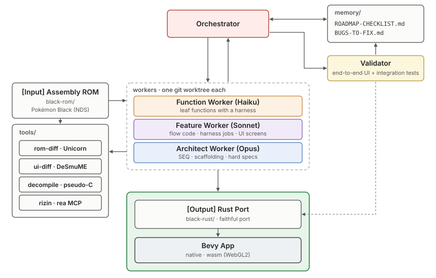
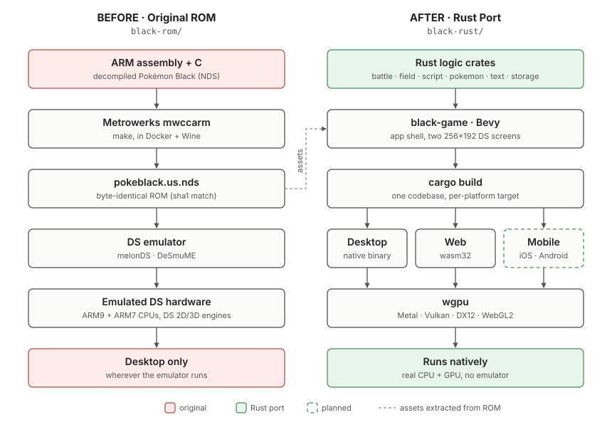

# Rust rewrite of Pokémon Black [](https://github.com/spencerlepine/black/actions/workflows/black-rust-ci.yml)

This directory holds a matching decompilation of Pokémon Black (`black-rom/`, C + ARM/Thumb asm) and a
from-scratch Rust port of it (`black-rust/`, a Cargo workspace). Game logic is ported function by
function and verified against the original machine code. UI, graphics and sound are rewritten in Bevy.

Two long-running Claude Code roles work on it:

| Role        | Prompt / source of truth                     | Does                                                                                                                  |
| ----------- | -------------------------------------------- | --------------------------------------------------------------------------------------------------------------------- |
| Coordinator | [`MIGRATION-AGENT.md`](MIGRATION-AGENT.md) + [`docs/migration/`](docs/migration/) | Plans, dispatches port jobs, merges, pushes `main`; progress is computed by `black-rust/tools/progress.py` |
| Validator   | [`VALIDATION-AGENT.md`](VALIDATION-AGENT.md) | Independently re-runs the original and the port on new commits; writes findings to `validation/` (never edits source) |





## 1. Prerequisites

### 1.1 Required tools

| Tool                     | Version used                                                               | Needed for                                                                             | Install                                                                                                                           |
| ------------------------ | -------------------------------------------------------------------------- | -------------------------------------------------------------------------------------- | --------------------------------------------------------------------------------------------------------------------------------- |
| git                      | any recent                                                                 | everything; worktrees are used heavily                                                 | `brew install git`                                                                                                                |
| Rust via **rustup**      | stable (1.99.0), with `clippy`, `rustfmt`, target `wasm32-unknown-unknown` | building, tests, gate                                                                  | `curl https://sh.rustup.rs -sSf \| sh`, then `rustup component add clippy rustfmt` and `rustup target add wasm32-unknown-unknown` |
| **JDK 21** (Temurin)     | 21.0.x                                                                     | Ghidra and the rea MCP server                                                          | `brew install openjdk@21` or `mise install java@temurin-21.0.12+8.0.LTS` (see §2.3 for the path the scripts expect)               |
| **Ghidra**               | 12.1.4 PUBLIC                                                              | bulk decompile (`tools/re/decompile.sh`)                                               | unzip to `~/tools/ghidra_12.1.4_PUBLIC` (see §2.2: Apple Silicon needs a native decompiler build)                                 |
| **rizin**                | 0.10.0                                                                     | disassembly queries on the synthesized ELF                                             | `brew install rizin`                                                                                                              |
| Python 3                 | 3.12 for the Unicorn venv (system python is used for the other scripts)    | `tools/rom-diff` differential harness, sync/queue scripts                              | `brew install python@3.12` or `mise install python@3.12`                                                                          |
| **Unicorn** (Python pkg) | latest from pip                                                            | runs original ARM/Thumb code in the harness                                            | created for you in `/tmp/blk/venv` by `doctor.sh`                                                                                 |
| Node.js + `npx`          | 24.x                                                                       | `npx rea-agents mcp` (reverse-engineering MCP server)                                  | `nvm install 24` or `brew install node`                                                                                           |
| **Claude Code** CLI      | current                                                                    | runs the coordinator and validator                                                     | see Anthropic docs; log in with a claude.ai plan                                                                                  |
| `jq`, `curl`             | any                                                                        | `.claude/scripts/usage-cap.sh` (plan-usage guard)                                      | `brew install jq` (curl ships with macOS)                                                                                         |
| `tmux`                   | any                                                                        | the coordinator runs unattended for days                                               | `brew install tmux`                                                                                                               |
| Disk                     | **≥ 40 GB free** (≥ 20 GB is the hard floor)                               | each worktree is ~2 GB, the Bevy `target/` is ~10 GB, decompile cache is in `/tmp/blk` |                                                                                                                                   |

### 1.2 Optional / situational

| Tool                                           | Needed for                                                                                                                                             | Notes                                                                                                                                                                      |
| ---------------------------------------------- | ------------------------------------------------------------------------------------------------------------------------------------------------------ | -------------------------------------------------------------------------------------------------------------------------------------------------------------------------- |
| **Docker** (`linux/amd64`)                     | Only to **rebuild** the original ROM from source (image `pokeblack-wine`, from `black-rom/Dockerfile.wine`) and as an `arm-none-eabi-objdump` fallback | Not needed if you copy `black-rom/build/` over (§2.4)                                                                                                                      |
| `wasm-bindgen-cli` 0.2.129 and `trunk` 0.21.14 | Browser playground / wasm builds (`black-battle-wasm`, `web/`)                                                                                         | `cargo install wasm-bindgen-cli --version 0.2.129 --locked`, `cargo install trunk --version 0.21.14 --locked`. The CLI version must equal the `wasm-bindgen` crate version |
| `ffmpeg` or `oggenc`                           | Asset extraction (music is rendered to OGG offline)                                                                                                    | `brew install ffmpeg`                                                                                                                                                      |
| Blender / Reality Converter                    | Eyeballing glTF map models                                                                                                                             | Only for human sign-off items                                                                                                                                              |
| Wine (32-bit capable)                          | The CodeWarrior compiler during a ROM rebuild                                                                                                          | Normally via the Docker image; native Wine is a Linux-only route                                                                                                           |

Not needed: an emulator, a Nintendo toolchain on the host, Bevy system libraries on macOS. On Linux,
Bevy needs the usual ALSA/udev/X11/Wayland dev packages if you build `black-game`; the validator and
logic-crate work skips Bevy with `GATE_NO_GAME=1`.

### 1.3 Proprietary / untracked inputs (cannot be fetched from git)

These are the part that normally trips up a second machine. Nothing here is in the repo:

| Item                                                                                        | Where                                          | Size    | How to get it on the new machine                                                                                                       |
| ------------------------------------------------------------------------------------------- | ---------------------------------------------- | ------- | -------------------------------------------------------------------------------------------------------------------------------------- |
| Built ROM + overlay binaries (`main.sbin`, `OVY_*.sbin`, `main.elf`, `pokeblack.us.nds`, …) | `black-rom/build/black.us/`                    | ~300 MB | **Copy from the working machine** (`rsync -a`), or rebuild (§2.4). This is the original machine code that every check compares against |
| CodeWarrior for DSi 1.1 (`mwccarm`)                                                         | `black-rom/tools/mwccarm/`                     | few MB  | Only for a rebuild. Proprietary; see `black-rom/INSTALL.md` §1                                                                         |
| TwlSDK 5.3 patch 1                                                                          | `black-rom/lib/NitroSDK/TwlSDK/`               | ~370 MB | Only for a rebuild. Proprietary; see `black-rom/INSTALL.md` §2                                                                         |
| Ghidra zip                                                                                  | `~/tools/dl/ghidra_12.1.4_PUBLIC_20260921.zip` | ~450 MB | Download from the Ghidra releases page                                                                                                 |
| Extracted game assets                                                                       | `black-rust/assets/` (gitignored, D5)          | large   | `black extract-assets`; only needed for `black-game`, not for validation                                                               |

`black-rom/files/` (the ROM filesystem, NARCs) **is** tracked in git, so a clone has it.

---

## 2. Setup on a new machine

### 2.1 Clone and place the repo

```sh
git clone https://github.com/spencerlepine/black.git $HOME/workplace/black
```

Use the **same absolute path**: `$HOME/workplace/black` is the single source of truth that
`MIGRATION-AGENT.md` (+ `docs/migration/ENV.md`), `VALIDATION-AGENT.md` and `.mcp.json` spell out. If you must clone elsewhere,
substitute the path in all three.

### 2.2 Rust

```sh
curl https://sh.rustup.rs -sSf | sh
. ~/.cargo/env
rustup component add clippy rustfmt
rustup target add wasm32-unknown-unknown
```

### 2.3 Java and Ghidra

The scripts default to `JAVA_HOME=$HOME/.local/share/mise/installs/java/temurin-21.0.12+8.0.LTS` and
`GHIDRA_INSTALL_DIR=$HOME/tools/ghidra_12.1.4_PUBLIC`. Either install JDK 21 with mise to that exact
path, or point the path at your JDK. The working macOS machine uses Homebrew's `openjdk@21` **symlinked
to the mise path**:

```sh
brew install openjdk@21
mkdir -p ~/.local/share/mise/installs/java
ln -s "$(brew --prefix openjdk@21)/libexec/openjdk.jdk/Contents/Home" \
      ~/.local/share/mise/installs/java/temurin-21.0.12+8.0.LTS
mkdir -p ~/tools && unzip ~/Downloads/ghidra_12.1.4_PUBLIC_*.zip -d ~/tools
```

`.mcp.json` reads the same two paths. Alternatively export `JAVA_HOME` and `GHIDRA_INSTALL_DIR` before
running anything; `doctor.sh` and `decompile.sh` honour both.

**Apple Silicon gotcha:** the Ghidra 12.1.4 release ships decompiler binaries for Linux and Windows only.
Without a native one, `doctor.sh` can pass while every `pc/*.c` file says `// decompile failed`. Build it:

```sh
cd ~/tools/ghidra_12.1.4_PUBLIC/Ghidra/Features/Decompiler/src/decompile/cpp
make ghidra_opt "ARCH_TYPE=-arch arm64"
# result must be at Ghidra/Features/Decompiler/os/mac_arm_64/decompile
```

(Needs Xcode command-line tools.) Check after decompiling: `grep -l "decompile failed" /tmp/blk/re/*/pc/*.c`
must print nothing. On Linux x86_64 none of this is needed.

### 2.4 The original ROM build (`black-rom/build/black.us/`)

Easiest: copy it from the working machine.

```sh
rsync -a olddev:$HOME/workplace/black/black-rom/build/ \
      $HOME/workplace/black/black-rom/build/
```

To rebuild instead, you need the two proprietary drops (CodeWarrior `mwccarm.zip`, TwlSDK
`TwlSDK-5_3-1-20090824.zip`) placed as described in `black-rom/INSTALL.md`, then build in the
`pokeblack-wine` Docker image (`docker build --platform linux/amd64 -f black-rom/Dockerfile.wine -t pokeblack-wine black-rom`).
Under Apple Silicon this runs through emulation and is slow.

Worktrees do not contain `build/`, so every check uses the absolute path:

```sh
export BLACK_ROM_BUILD=$HOME/workplace/black/black-rom/build/black.us
```

### 2.5 Python, Unicorn venv, decompile cache

`doctor.sh` does all of this and reports what is missing. Run it first and after every reboot, because
`/tmp/blk` is ephemeral:

```sh
sh $HOME/workplace/black/black-rust/tools/doctor.sh
```

It checks cargo, the wasm target, the ROM build, JDK 21, Ghidra and rizin; (re)creates `/tmp/blk/venv`
with Unicorn; and runs Ghidra over each overlay set in `tools/re/sets.txt` (`battle`, `field`) to produce
`/tmp/blk/re/<set>/pc/*.c` (about 3 minutes per set; ~12,000 functions for `battle`). Exit 1 means a
human must fix something. The venv is built from a **mise Python 3.12** at
`~/.local/share/mise/installs/python/3.12*/bin/python3`; if you use another Python 3.12, create the venv
manually:

```sh
mkdir -p /tmp/blk && python3.12 -m venv /tmp/blk/venv && /tmp/blk/venv/bin/pip install unicorn
```

The harness is always run as `/tmp/blk/venv/bin/python -I`.

### 2.6 Claude Code and the rea MCP server

- `cd` into this directory before running `claude`, so it loads `.claude/settings.json` (permission
  allowlist) and `.mcp.json` (the `rea` MCP server over Ghidra via `npx rea-agents mcp`).
- First `rea` query on a binary takes ~97 s (analysis); later ones are near-instant.
- Launching from here means the `spirited/.claude/settings.json` hooks are **not** loaded (by design).
- The coordinator's usage guard (`.claude/scripts/usage-cap.sh`) reads the Claude Code OAuth token from
  the macOS keychain (`security`) or `~/.claude/.credentials.json`, so log in with a claude.ai plan.
- Project memory under `~/.claude/projects/...` is per machine and does not travel.

---

## 3. Verify the machine

```sh
. ~/.cargo/env
G=$HOME/workplace/black
sh $G/black-rust/tools/doctor.sh                                  # every line "ok"
cd $G/black-rust && GATE_NO_GAME=1 tools/gate.sh                  # fmt, clippy, tests, release build (no Bevy)
```

Use a separate target dir per worktree to avoid clobbering: `export CARGO_TARGET_DIR=/tmp/blk/target-<name>`.
The first `cargo test` in a fresh target dir compiles the whole workspace (~3–5 min without Bevy).
The full `tools/gate.sh` (with `black-game` and the wasm build) needs ~10 GB more.

## 4. Running the two roles

**Coordinator** (long, unattended; see `MIGRATION-AGENT.md` §0 for the exact prompt and its "Reading order" table for the files under `docs/migration/`):

```sh
tmux new -s rewrite
cd $HOME/workplace/black && claude
# paste the /loop prompt from MIGRATION-AGENT.md §0
```

**Validator** (one run, then exit): launch `claude` from the repo root with the contents of
`VALIDATION-AGENT.md` as the prompt. It needs `git fetch origin` access, the tools above, and a warm
`/tmp/blk/target-validate`; it uses `/tmp/blk/wt-validate` as a scratch worktree and writes only
`validation/{COMMITS.csv,VALIDATION.md,RUNS.md}`. Budget per run: ~11 min warm, +5 min cold compile.
Per-area check commands, from a worktree's `black-rust/`:

```sh
tools/check-svflow.sh AREA --per-function
tools/check-fn.sh CRATE AREA --per-function
tools/check-handlers.sh abilities|items|moves|effects --per-function
```

Always run git as `git -C <repo root> …` so a stray `cd` in an earlier shell can't send a command to
the wrong directory.

## 5. Troubleshooting

| Symptom                                                   | Cause / fix                                                               |
| --------------------------------------------------------- | ------------------------------------------------------------------------- |
| `doctor.sh`: `FAIL ROM build`                             | `black-rom/build/black.us` missing; copy it (§2.4)                        |
| `doctor.sh`: `FAIL JDK` / `Ghidra`                        | Wrong path; see §2.3 or export `JAVA_HOME` / `GHIDRA_INSTALL_DIR`         |
| `doctor.sh` all ok but `pc/` files say `decompile failed` | No native Ghidra decompiler (Apple Silicon); see §2.3                     |
| `FAIL venv`                                               | No mise Python 3.12; create `/tmp/blk/venv` by hand (§2.5)                |
| Checks fail after reboot                                  | `/tmp/blk` was wiped; rerun `doctor.sh`                                   |
| `wasm-bindgen` mismatch errors                            | CLI version must equal the crate version (0.2.129)                        |
| `check-*.sh` exits 2 "no … tests.rs"                      | Area has a spec but no ported functions yet; not a failure                |
| Disk fills up                                             | Delete old `/tmp/blk/target-*` dirs and stale worktrees; keep ≤ 4 workers |
